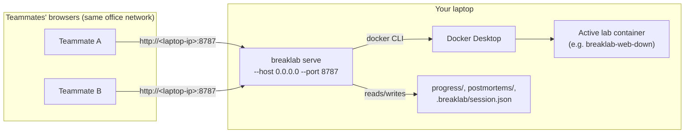

# Quick win: sharing BreakLab from your own laptop

The fastest way to let your team try BreakLab is to run it on the laptop
you're already using and point their browsers at it — no Pi, no cloud,
no install on their end. This takes minutes but has one important limit
(read "What this is not" below) before you invite anyone in.

## What this is

One `breaklab serve` process, running on your laptop, reachable by
anyone on the same network over plain HTTP:



Labs run as Docker containers on your laptop, not on each teammate's
machine — your CPU/RAM takes the load, and `docker exec` runs against
your Docker socket.

## What this is NOT

**There is exactly one active lab session for the whole server**,
tracked in a single `.breaklab/session.json` on your laptop. This is
not a multiplayer app — if teammate A starts `web-down`, everyone who
opens the dashboard sees *that same* incident, and if teammate B clicks
"Start" on a different lab, the runner returns a "lab already running"
error (or displaces it, if they confirm). Good for one person driving
while others watch, or a team rotating through one lab at a time; not
good for everyone solving different labs simultaneously — for that,
each person needs their own instance (see `docs/devops-guide-azure.md`
for isolated per-learner instances).

There's also **no authentication** — anyone who can reach the port can
see the dashboard, start/stop labs, and run `docker exec` through it.

## Prerequisites

- Docker Desktop (or Docker Engine) running on your laptop — BreakLab
  shells out to the `docker` CLI.
- Go and Node installed, to build the binary and frontend.
- A free TCP port (default `8787`).
- Teammates on the same LAN/office Wi-Fi as your laptop. A VPN or a
  client-isolated/guest Wi-Fi network will block this even though it
  looks like "the same network" — test with one teammate before
  announcing it to everyone.

## 1. Build once

```bash
cd breaklab
cd frontend && npm ci && npm run build && cd ..   # builds frontend/dist/
go build -o breaklab ./cmd/breaklab
```

## 2. Find your laptop's LAN IP

```bash
# macOS
ipconfig getifaddr en0
# Linux
hostname -I
# Windows (PowerShell)
ipconfig | findstr IPv4
```

Note the address (e.g. `192.168.0.13`) — that's what you'll give your
team.

## 3. Start the server bound to all interfaces

```bash
./breaklab serve --host 0.0.0.0 --port 8787
```

`--host 0.0.0.0` is required — the default (`127.0.0.1`) only accepts
connections from the laptop itself. The CLI prints a one-time warning
about the missing authentication when you bind a non-loopback host;
that warning is the point, not a bug.

Leave this terminal open — `Ctrl+C` stops the server (and ends the
shared session for everyone currently using it).

## 4. Share the URL

```
http://<your-laptop-ip>:8787
```

e.g. `http://192.168.0.13:8787`. Anyone on the same network can now open
it in a browser.

## Known limits

- **One shared session.** See "What this is NOT" above.
- **Sleep kills it.** Closing the lid or letting the laptop sleep drops
  every connection. For a short demo this is fine; for anything longer,
  disable sleep for the session (e.g. `caffeinate` on macOS) or keep the
  lid open.
- **No auth, no TLS.** Office network only — never port-forward 8787 to
  the internet, never do this on an untrusted network.
- **Your laptop is the bottleneck.** One learner's container competing
  for CPU/memory affects everyone watching.

## When to outgrow this

If this becomes a recurring thing rather than a one-off demo, see:

- [`docs/deploy-raspberry-pi.md`](deploy-raspberry-pi.md) — one
  dedicated always-on box on your LAN, running as a systemd service.
- [`docs/devops-guide-azure.md`](devops-guide-azure.md) — isolated,
  disposable instances per learner in the cloud, so everyone can run a
  different lab at the same time.
