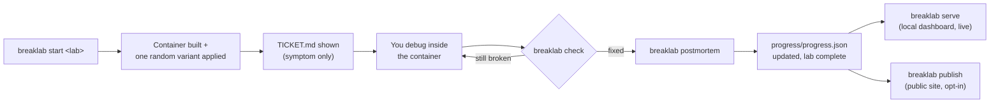
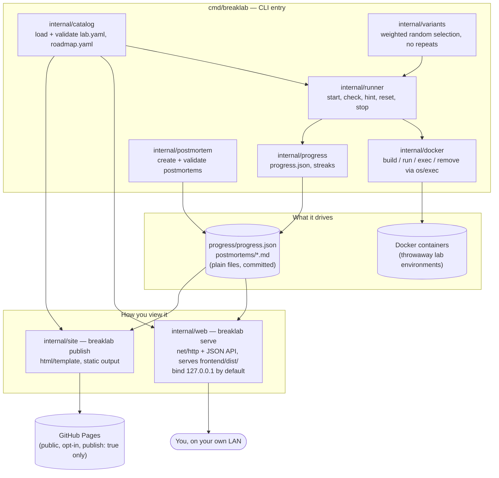

# BreakLab Developer Guide

This is the raw-features reference: how BreakLab actually works
underneath the CLI, where every piece lives, and what the contracts
between them are. Read `PRODUCT.md` first if you want the *why*; this
doc is the *how*.

## 1. The loop, mechanically



`start` and `check` never talk to each other directly — `start` writes
which lab and which variant are active to `.breaklab/session.json`
(gitignored); `check` reads that file to know which container and which
`check.sh` to run. There is no server process holding state between
commands; every command is a short-lived CLI invocation.

## 2. Architecture



Repo layout:

```text
breaklab/
  cmd/breaklab/           CLI entry, subcommand wiring (list, lab, status,
                          postmortem, serve, publish, login, sync)
  internal/
    catalog/              load and validate lab.yaml, roadmap.yaml
    docker/                build, run, exec, remove via the docker CLI
    variants/              weighted random selection, no repeats
    runner/                start, check, hint, reset, stop
    progress/              progress.json and streaks
    postmortem/            create and validate postmortems
    site/                  builds site/ with html/template (public, publish-triggered)
    web/                   breaklab serve: local HTTP server, JSON API, reads live files
                          (includes the opt-in --db account/sync layer, see §4)
    audit/                 security-audit checks (CI workflows, dependencies, gitignore)
  labs/<lab-id>/           one folder per lab: lab.yaml, TICKET.md, Dockerfile,
                          check.sh, variants/, solutions/ — data, not code
  frontend/                Astro + Astryx local app and hosted-account pages;
                          builds to frontend/dist/, served by internal/web
  templates/
    web/                   vendored static assets only (fonts, cytoscape.min.js) —
                          every page template moved to frontend/
    site/                  public site templates (breaklab publish, unaffected by frontend/)
    postmortem.md          postmortem template copied by `breaklab postmortem`
  roadmap.yaml             phase + stage order, drives the CLI, web UI, and site
  progress/progress.json   attempt history (plain file, committed)
  postmortems/             postmortems (plain files, committed)
  docs/                    this file, breaklab-spec.md, deploy-raspberry-pi.md,
                          learner-guide.md, devops-guide-azure.md
  .github/workflows/       ci.yml, publish.yml
```

Why the shape is this way:

- **Labs are data, not code.** Adding or editing a lab never touches
  `internal/`. `internal/catalog` validates `lab.yaml` against a schema at
  load time, so a malformed lab fails fast with a specific error instead
  of panicking deep in `runner`.
- **`internal/docker` only shells out with argument slices.** No shell
  string is ever built from a lab ID, container name, or port — this is a
  security boundary, not a style preference (see §6).
- **`internal/web` has two layers that must not blur together**: the
  always-on, unauthenticated local dashboard (`serve`, no flags) and the
  opt-in `--db` hosted-account layer (signup/login/sync). They share an
  HTTP server but not a trust model — see §4.

## 3. CLI reference

| Command | What it does |
|---|---|
| `breaklab list` | List labs grouped by roadmap stage |
| `breaklab start <lab>` | Build a container and apply one random breakage |
| `breaklab check` | Check whether the active lab is fixed |
| `breaklab hint` | Reveal the next hint for the active lab (tiered, counted) |
| `breaklab reset` | Recreate the active lab with the same breakage |
| `breaklab stop` | Remove the active lab's container |
| `breaklab status` | Show per-stage progress, the active lab, and your streak |
| `breaklab postmortem` | Write up or validate a postmortem for a solved lab |
| `breaklab publish` | Rebuild `site/` from progress, labs, and published postmortems |
| `breaklab serve [--host] [--port] [--frontend] [--db]` | Serve the local dashboard, phases view, and challenge browser |
| `breaklab login [--server] [--token]` | Link this machine to a hosted `--db` account (writes `.breaklab/account.json`) |
| `breaklab sync` | Push/pull `progress/progress.json` attempts against a linked hosted account |

Every command has `--help`. `serve` binds to `127.0.0.1` by default;
`--host 0.0.0.0` is opt-in and prints a one-time warning — the dashboard
has no authentication by design unless `--db` is set.

`login`/`sync` only ever exchange `progress.json` attempt records with a
hosted server — lab execution (building images, running containers)
always stays local. There is no server-side Docker in this codebase.

## 4. Two trust models in `internal/web`

| | `breaklab serve` | `breaklab serve --db <path>` |
|---|---|---|
| Auth | None | Real accounts: passwords, sessions, API tokens |
| MFA | N/A | None implemented — do not treat as hardened |
| Intended exposure | Loopback or trusted LAN only | Behind TLS, with real exposure planning |
| What it serves | Dashboard, phases view, challenge browser, lab/postmortem viewer | Above, plus signup/login, `sync` API, opt-in public profile (`/u/<name>`) |

Never add `--db` to a deployment as a way to "add a login screen" to an
otherwise-exposed instance — it adds credential storage, which raises the
bar for what hosting that instance responsibly requires. See
`docs/devops-guide-azure.md` for how multi-learner deployments are
expected to get isolation (one instance per learner) instead of reaching
for `--db`.

## 5. Lab format and script contracts

```text
labs/web-down/
  lab.yaml             # metadata, variants, hints, tags, loop: (learn/guided/practice)
  TICKET.md            # the symptom only, never the cause
  Dockerfile            # the healthy environment
  check.sh              # exit 0 = fixed
  variants/             # each applies one breakage inside the container
    config-typo.sh
    port-taken.sh
    bad-perms.sh
  solutions/             # reference fixes, used only by automated tests
    config-typo.sh
    port-taken.sh
    bad-perms.sh
```

- **Variant scripts** run inside the container as root after it starts;
  they leave the environment broken and must exit 0 themselves (a
  variant that crashes is treated as a bug in the lab, not a harder
  challenge).
- **Check scripts** print one line explaining the result and receive
  `BREAKLAB_CONTAINER` and `BREAKLAB_PORT_<container-port>` as environment
  variables. Exit 0 = fixed.
- **Solution scripts** apply the reference fix for one variant. The CLI
  never runs these for a learner — only `go test ./...`'s integration
  tests do, to prove each variant is actually fixable by its own
  solution.
- **Hints** (top-level `hints:` and per-variant `hints:`) point at a
  diagnostic command, never at the literal fix — see the lab narrative
  format in `AGENTS.md` if you're authoring a new lab with an AI agent.

`roadmap.yaml` groups stages under phases and is the single source of
truth for stage order across the CLI, web UI, and public site — see
`AGENTS.md` for the current phase/stage list (it changes more often than
this doc).

## 6. Security posture

This is a product constraint, not an afterthought, enforced at the code
level:

- `os/exec` with argument slices only — never a shell string built from
  user- or lab-controlled input (`internal/docker`).
- Lab/image/container/volume names validated against `^[a-z0-9-]+$`
  before they touch Docker or a filesystem path.
- `govulncheck` runs in CI as a Go dependency audit gate; `npm run audit`
  is the equivalent for `frontend/`.
- `gitleaks` runs in CI (`secret-scan` job, `.github/workflows/ci.yml`) on
  every push and PR, scanning full git history, not just the diff —
  the OSS CLI run directly via `go run`, same shape as `govulncheck`,
  not the third-party Action (which requires an org license on private
  repos). Real false positives — this repo's own lab content teaches
  secrets/auth incidents and legitimately contains fake, secret-shaped
  strings — are allowlisted by exact path or value in `.gitleaks.toml`,
  never by disabling a rule outright. **Adding a lab whose fixture looks
  like a real credential?** Add it to `.gitleaks.toml` with a one-line
  reason in the same change, don't wait for CI to fail on `main`.
- GitHub Actions are SHA-pinned, not tag-pinned, and every workflow's
  `checkout` step sets `persist-credentials: false` — a later step in a
  compromised dependency can't reuse the runner's git token to push.
  Workflow permissions default to `contents: read`; a job that needs
  more (`deploy.yml`'s `packages: write`) declares it at the job level,
  not the workflow level, so unrelated jobs in the same file don't
  inherit privilege they don't use.
- The runtime Docker image (`Dockerfile`) runs as a fixed non-root UID
  (`breaklab`, 10001), never root — see §7.
- `internal/audit` runs these checks (CI workflow shape, dependency
  freshness, `.gitignore` coverage) and is itself tested.

## 7. Build, test, and CI

```bash
gofmt -l .           # formatting
go vet ./...         # static checks
go test ./...        # unit + integration tests (Docker required for lab integration tests)

cd frontend
npm run audit        # npm audit --omit=dev --audit-level=high
npm run build        # also catches Astro/TypeScript errors
```

Go's test fixtures never read the real `frontend/dist` — any test that
needs a `FrontendDir` builds its own minimal stub, so `go test ./...`
passes without running the frontend build first.

CI (`.github/workflows/ci.yml`) runs the frontend install/audit/build
step, then `gofmt`, `go vet`, `go test ./...`, and the lab integration
tests on `ubuntu-latest` on every pull request, plus a `linux/arm64`
cross-compile as a build smoke check for the Raspberry Pi 5 target.

**Release builds are stripped.** Any build whose binary actually ships
(the Dockerfile, `docs/deploy-raspberry-pi.md`, `publish.yml`, the Azure
artifact pipeline in `docs/devops-guide-azure.md`) uses:

```bash
go build -trimpath -ldflags="-s -w" -o breaklab ./cmd/breaklab
```

`-s -w` drops the symbol table and DWARF debug info; `-trimpath` drops
build-machine file paths. Measured locally: 19M → 13M, ~30% smaller, no
behavior change. It also means `dlv`/`gdb` can't attach meaningfully to
that binary — build without the flags for a debugging session, same as
you would for any other Go release binary.

**The container image runs as a fixed non-root user.** `Dockerfile`'s
runtime stage creates `breaklab` (UID/GID 10001) and drops to it with
`USER breaklab` before `ENTRYPOINT`. Because the whole point of this
image is to shell out to the host's `docker` CLI, it needs the host's
`docker.sock` bind-mounted in, and that socket's group GID varies per
host and can't be baked into the image at build time — run the
container with `--group-add $(stat -c '%g' /var/run/docker.sock)` (or
the Kubernetes equivalent, `securityContext.supplementalGroups`). See
the comment above `ENTRYPOINT` in `Dockerfile` for the exact flag.

## 8. Frontend

`frontend/` is an [Astro](https://astro.build) +
[Astryx](https://astryx.atmeta.com) project that builds to static
HTML/JS/CSS; Go serves that build output from disk (`--frontend`,
defaulting to `frontend/dist`) — there is no Node process at request
time, only at build time. Rebuild `frontend/dist` (`npm run build`)
whenever anything under `frontend/src/` changes; `breaklab serve` always
reads it from disk, live.

For frontend development, run Astro's dev server and the Go backend side
by side — `npm run dev` (in `frontend/`) proxies `/api/*`, `/sync/*`,
`/signup`, `/login`, etc. to `breaklab serve` on `:8787`, so a browser
pointed at the Astro dev origin (typically `:4321`) gets live-reloading
frontend changes against a real backend.

Design system (palette, type, contrast rules) is recorded in `DESIGN.md`
with its `.impeccable/design.json` sidecar — don't hand-roll new color
values; pull from the existing tokens in `templates/web/style.css`.

## 9. Where to go next

- Deploying one instance for yourself: `docs/deploy-raspberry-pi.md`.
- Provisioning many isolated instances for a cohort of learners:
  `docs/devops-guide-azure.md`.
- What a learner actually does day to day: `docs/learner-guide.md`.
