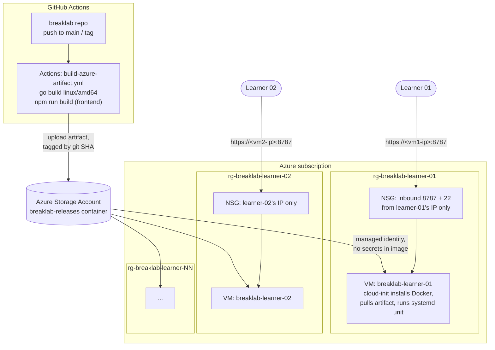

# BreakLab DevOps Guide — Azure

You're provisioning BreakLab for a cohort of learners, each of whom needs
their own working instance, not a shared one. This doc covers Azure.
GCP and AWS versions follow the same shape and will live alongside this
one as `devops-guide-gcp.md` / `devops-guide-aws.md` once written —
don't build those yet.

Read this end to end before running anything. It's written for a junior
engineer who hasn't provisioned cloud infra for this app before; every
command states why it's there, not just what it does.

## 1. The shape of the problem

BreakLab is a single-user tool by design (see `PRODUCT.md`) — it shells
out directly to a `docker` CLI it controls, and `breaklab serve` has no
authentication. There is no multi-tenant mode to turn on. So "give 30
learners access" does not mean "stand up one BreakLab and give everyone
the URL" — it means **one isolated instance per learner**, same as the
team's existing Proxmox deployment gives each teammate their own LXC
(see `AGENTS.md`). In Azure, the unit of isolation is:

- **One resource group per learner.** Everything that learner's sandbox
  owns lives in it. Teardown is `az group delete` — one command, nothing
  left behind, no risk of deleting another learner's VM by mistake.
- **One VM per learner**, not a shared VM with multiple containers.
  BreakLab needs a real Docker daemon it owns; sharing one daemon across
  learners means one learner's `breaklab start` can see or disrupt
  another's containers. A VM per learner is the honest equivalent of the
  LXC-per-teammate model, just on Azure instead of Proxmox.
- **Network access scoped to that one learner**, never a public
  `0.0.0.0:8787`. `breaklab serve` has no login screen — anyone who can
  reach the port can see everything in it.



## 2. Prerequisites

- An Azure subscription you (or your team) control, and
  [`az` CLI](https://learn.microsoft.com/cli/azure/install-azure-cli)
  installed and logged in (`az login`).
- [Terraform](https://developer.hashicorp.com/terraform/install) ≥ 1.9 —
  the module in `deploy/terraform/azure/` is pinned to `azurerm ~> 4.0`
  and has been run through `terraform fmt`/`validate` (not `apply` —
  that still needs a real subscription and your own review).
- The BreakLab repo on GitHub (github.com, as it already is here —
  `github.com/uanandu/breaklab`) with Actions enabled, which it is by
  default on a GitHub-hosted runner. No self-hosted runner is needed
  unless you move to GitHub Enterprise with restricted egress — see the
  note in §10.
- One public IP per learner you can reach them at, or a known egress IP
  for the room/VPN they'll connect from (for the NSG rule in §4). If you
  don't have this ahead of time, see the Bastion alternative in §6.

The old `deploy/terraform/` (a one-commit, unfinished DigitalOcean
experiment — `main.tf` was empty) has been removed. `deploy/terraform/azure/`
below is the only Terraform in the repo now.

## 3. Step 1 — CI builds the artifact, in GitHub Actions

The VM never builds BreakLab itself — it downloads a prebuilt binary and
frontend bundle. This keeps the VM image dumb (no Go/Node toolchain to
patch and secure) and makes "what's running" exactly "what Actions
built," matching the same cross-compile discipline the Pi guide uses.

The workflow is already in the repo at
[`.github/workflows/build-azure-artifact.yml`](../.github/workflows/build-azure-artifact.yml)
— don't retype it, read it there. It follows the same house style as
`ci.yml`/`deploy.yml`/`publish.yml`: every action pinned to a commit SHA
(not a floating tag), `persist-credentials: false` on checkout, and only
the permissions each job actually needs (`id-token: write` here, for
OIDC — nothing else).

It uses OIDC federated login (`azure/login` with `id-token: write`), not
a stored service principal secret — one less long-lived credential to
leak or rotate. `AZURE_CLIENT_ID`/`AZURE_TENANT_ID`/
`AZURE_SUBSCRIPTION_ID` identify the federated app registration, not a
password. That trust has to be set up once, by you, before the workflow
can log in:

```bash
# 1. App registration the workflow authenticates as
az ad app create --display-name breaklab-gha-azure-artifact
APP_ID=$(az ad app list --display-name breaklab-gha-azure-artifact --query "[0].appId" -o tsv)
az ad sp create --id "$APP_ID"   # service principal for that app

# 2. Federated credential: trusts GitHub Actions tokens from this repo's
#    main branch specifically — not any branch, not any repo.
az ad app federated-credential create --id "$APP_ID" --parameters '{
  "name": "breaklab-main-branch",
  "issuer": "https://token.actions.githubusercontent.com",
  "subject": "repo:<org-or-user>/breaklab:ref:refs/heads/main",
  "audiences": ["api://AzureADTokenExchange"]
}'

# 3. Grant it just enough to upload to the releases storage account
#    (Storage Blob Data Contributor, scoped to that one storage account —
#    not Contributor on the subscription).
az role assignment create \
  --assignee "$APP_ID" \
  --role "Storage Blob Data Contributor" \
  --scope "$(az storage account show -n breaklabreleases -g rg-breaklab-releases --query id -o tsv)"

# 4. Values the workflow reads as secrets — add these in
#    Settings → Secrets and variables → Actions on the GitHub repo
#    (or `gh secret set NAME --body "value"` from this shell).
echo "AZURE_CLIENT_ID=$APP_ID"
az account show --query "{AZURE_TENANT_ID:tenantId, AZURE_SUBSCRIPTION_ID:id}" -o json
```

If you'd rather trust *any* branch/tag or a separate deploy branch, adjust
the `subject` in step 2 to match (`ref:refs/tags/*`, a different branch,
etc.) — the federated credential is what actually enforces which pushes
are allowed to assume this identity, so keep it as narrow as your release
process allows.

The storage account itself (`breaklabreleases`) is created once, outside
per-learner Terraform — it's shared infrastructure, not something that
gets torn down between cohorts:

```bash
az group create -n rg-breaklab-releases -l eastus
az storage account create -n breaklabreleases -g rg-breaklab-releases \
  -l eastus --sku Standard_LRS
az storage container create --account-name breaklabreleases \
  -n breaklab-releases --auth-mode login
```

## 4. Step 2 — the per-learner Terraform module

The module lives in `deploy/terraform/azure/` and is already in the
repo — don't retype it, read it there:

- [`versions.tf`](../deploy/terraform/azure/versions.tf) — provider pin
  (`azurerm ~> 4.0`, Terraform ≥ 1.9).
- [`variables.tf`](../deploy/terraform/azure/variables.tf) — `learners`
  (name → allowed IP CIDR), `location`, `vm_size`, `admin_username`,
  `ssh_public_key`, plus the shared releases storage account's name and
  resource group.
- [`main.tf`](../deploy/terraform/azure/main.tf) — one resource group,
  VNet, subnet, NSG, public IP, NIC, and Linux VM per entry in
  `var.learners` (via `for_each`), a system-assigned managed identity on
  each VM, and an `azurerm_role_assignment` granting that identity
  `Storage Blob Data Reader` on the shared releases storage account —
  that's what lets cloud-init pull the artifact with no secret baked
  into the image.
- [`cloud-init.yaml.tftpl`](../deploy/terraform/azure/cloud-init.yaml.tftpl) —
  installs Docker and the Azure CLI, logs in with the VM's managed
  identity (`az login --identity`, no stored credential), downloads
  `breaklab-latest.tar.gz`, and installs the same systemd unit shape as
  `docs/deploy-raspberry-pi.md`, just written by cloud-init on first
  boot instead of by hand over SSH.
- [`terraform.tfvars.example`](../deploy/terraform/azure/terraform.tfvars.example) —
  copy to `terraform.tfvars` (gitignored — it holds real learner IPs) and
  fill in.

This has been run through `terraform init -backend=false` and
`terraform validate` against the real `azurerm` provider schema — the
HCL is syntactically and referentially sound. It has **not** been
`apply`'d against a live subscription; review it against your own
naming/tagging conventions before you point it at one.

`--host 0.0.0.0` in the systemd unit is safe *only* because the NSG in
`main.tf` already restricts inbound 8787 to that one learner's IP — the
same warning from `docs/deploy-raspberry-pi.md` about this flag applies;
the NSG is what's actually doing the access control, not the flag.

The Azure CLI is in the cloud-init `packages:` list for simplicity
(slower first boot); bake a custom image with it preinstalled via
[Azure Image
Builder](https://learn.microsoft.com/azure/virtual-machines/image-builder-overview)
once you're provisioning more than a handful of learners at a time.

## 5. Step 3 — provision a cohort

```bash
cd deploy/terraform/azure
cp terraform.tfvars.example terraform.tfvars
$EDITOR terraform.tfvars    # real learner names + IPs, your ssh_public_key

terraform init
terraform plan -out=cohort.plan
terraform apply cohort.plan
terraform output learner_ips
```

Expected result: one resource group, VM, and NSG per entry in
`learners`, and a map of learner name → public IP from the final
command. First boot takes a few minutes while cloud-init installs
Docker and pulls the artifact — `breaklab` isn't reachable until that
finishes.

## 6. Step 4 — verify one sandbox before handing out URLs

```bash
ssh breaklab@<learner-01-ip>
sudo systemctl status breaklab.service   # expect: active (running)
./opt/breaklab/breaklab list             # confirms the catalog loaded
exit

curl -sf http://<learner-01-ip>:8787/ -o /dev/null && echo "UI reachable"
```

Run this from the learner's own network/IP if possible — the NSG will
reject the `curl` from anywhere else, which is correct, but means you
can't sanity-check reachability from your own laptop unless your IP is
also in `learners` (don't add it permanently; use a throwaway entry and
`terraform apply` again to remove it once you're done).

**If you don't have learner IPs ahead of time** (a public classroom,
rotating Wi-Fi), swap the NSG-per-IP model for [Azure
Bastion](https://learn.microsoft.com/azure/bastion/bastion-overview) or
a jump host: close 8787 to the internet entirely, require an
authenticated SSH/Bastion hop, and have the learner reach the UI via SSH
port-forward (`ssh -L 8787:localhost:8787 breaklab@<vm-ip>`). This is
more setup but doesn't depend on knowing IPs in advance — mention this
to your team before you build it, since it changes the Terraform module
(no public IP on the NIC, a Bastion resource instead).

## 7. Lifecycle and cost

- **Size:** `Standard_B2s` (2 vCPU, 4 GiB) is the default here — enough
  to build and run one lab's container at a time, which is all a single
  learner ever has active. Bump it only if a specific lab's image is
  unusually heavy.
- **Auto-shutdown:** add an `azurerm_dev_test_global_vm_shutdown_schedule`
  resource per VM if the cohort runs on a schedule (e.g. shut down
  19:00–08:00 daily) — pure cost control, learners' containers and
  progress files on disk aren't affected by a VM being powered off.
- **Teardown at the end of a cohort:**
  ```bash
  terraform destroy
  ```
  This deletes every resource group in one pass. There is nothing to
  clean up by hand — that's the point of one resource group per learner.
- **Before you destroy:** tell learners to commit and push
  `progress/progress.json` and `postmortems/*.md` to their own fork —
  see `docs/learner-guide.md` §6. `terraform destroy` does not back
  anything up for them.

## 8. Day-2: shipping an update to a live cohort

CI (`build-azure-artifact.yml`) refreshes `breaklab-latest.tar.gz` on
every push to `main`, but running VMs don't auto-pull it — redeploy
explicitly, the same discipline as the Pi guide's step 7:

```bash
for ip in $(terraform output -json learner_ips | jq -r '.[]'); do
  az vm run-command invoke \
    --resource-group "rg-breaklab-$(terraform output -json learner_ips | jq -r --arg ip "$ip" 'to_entries[] | select(.value==$ip) | .key')" \
    --name "vm-breaklab-..." \
    --command-id RunShellScript \
    --scripts "az storage blob download --account-name breaklabreleases --container-name breaklab-releases --name breaklab-latest.tar.gz --file /opt/breaklab/release.tar.gz --auth-mode login && tar xzf /opt/breaklab/release.tar.gz -C /opt/breaklab && systemctl restart breaklab.service"
done
```

This loop is intentionally manual and visible rather than a
self-updating timer on the VM — for a classroom-sized cohort, "redeploy
when I say so" is safer than a background poller that might restart
someone's VM mid-lab. If you outgrow this (dozens of learners, frequent
releases), revisit with your team before automating it further; don't
build the automation speculatively.

## 9. Troubleshooting

- **`breaklab.service` is `activating` forever** — cloud-init is still
  running (Docker install + artifact download). Check
  `cloud-init status --wait` and `journalctl -u breaklab.service -f`
  before assuming it's broken.
- **`curl` to 8787 times out from the learner's machine** — their egress
  IP changed (common on university/corporate Wi-Fi or VPN). Update that
  learner's entry in `terraform.tfvars` and `terraform apply`; it only
  touches that one NSG rule.
- **`az storage blob download` fails on first boot** — usually the
  VM's managed identity role assignment hasn't propagated yet (Azure RBAC
  can lag a minute or two after `terraform apply`). Re-run
  `cloud-init single --name runcmd` on the VM once, or just wait and
  reboot.
- **A learner's container build is slow/fails on first `breaklab
  start`** — confirm `docker run --rm hello-world` works on that VM
  first; if Docker itself is fine, it's a lab issue, not an infra one.

## 10. What this doesn't cover yet

- GCP and AWS equivalents (`devops-guide-gcp.md`, `devops-guide-aws.md`)
  — same per-learner isolation model, different IaC provider. Don't
  start these until Azure is running for a real cohort and this doc has
  been corrected against reality.
- This guide assumes GitHub-hosted Actions runners can reach the public
  internet to reach Azure (true by default on github.com). If you later
  move to GitHub Enterprise Server with restricted egress, you'll need a
  self-hosted runner inside Azure instead — flag that to whoever owns
  the GHE instance before you're blocked on it.
