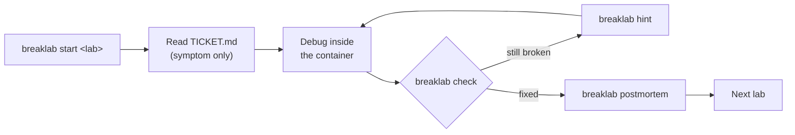

# BreakLab Learner Guide

You've been given access to a BreakLab sandbox. Someone else provisioned
it — you don't need to build anything or touch cloud infrastructure to
use it. This doc is everything you need to actually learn from it.

## 1. What this is, honestly

BreakLab gives you a container that's broken in some way, and a ticket
that tells you the *symptom* — never the cause. That's deliberate. In a
real incident nobody hands you the root cause up front; you find it. If
this doc told you how each lab breaks, it would defeat the point of
doing the lab.

## 2. The loop



```bash
./breaklab list                     # see every lab, grouped by stage
./breaklab start web-down           # builds the container, applies one breakage
cat labs/web-down/TICKET.md         # or just read it in the web UI
docker exec -it breaklab-web-down bash   # get a shell inside
# ...debug...
./breaklab check                    # tells you pass/fail, not what's wrong
./breaklab hint                     # if you're stuck — see §4 before you reach for this
./breaklab postmortem               # required before the lab counts as done
./breaklab reset                    # same lab, same breakage, clean container
./breaklab stop                     # done for now, remove the container
```

`breaklab serve` is probably already running for you — if it is, open
the URL you were given (ask whoever set up your sandbox) and you get a
dashboard, the phases view, and a lab browser instead of using raw CLI
commands. Everything the web UI shows is read from the same files the
CLI writes; neither one is more "official" than the other.

## 3. The phases view

`breaklab list` and the web UI's phases view are both driven by the
same stage order: Linux fundamentals → Networking & Web → Git → Docker →
CI/CD → Infrastructure as code → Kubernetes (fundamentals, developer,
admin, security) → Monitoring & logging → Capstone. Work in order the
first time through — later stages assume you're fluent with earlier
ones' tools, and the hints get sparser as difficulty rises.

Each lab's difficulty and estimated time are shown before you start it.
If a lab's estimate is 20 minutes and you're at 90, that's a signal to
use a hint, not to keep brute-forcing — see below.

## 4. Using hints without cheating yourself

Hints are tiered on purpose: general hints come before the active
variant's specific ones, and each reveal is counted. The count isn't
there to shame you — it's there so your own postmortem (and your
instructor, if you have one) can see how much of the fix you actually
found versus were handed. A lab solved with 4 hints and a lab solved
with 0 taught you different amounts; both are legitimate, but know which
one you did.

What's off-limits: looking inside a lab's `variants/` or `solutions/`
folders. Those exist for the automated tests, not for you — opening them
is the one way to make a lab worthless to yourself. Nothing stops you
technically; this only works if you don't.

## 5. The postmortem is the actual deliverable

`breaklab check` passing means the symptom is gone. The lab isn't
*done* until `breaklab postmortem` has real content in all five
sections — Summary, Detection, Root cause, Fix, Prevention, 20+ words
each. This isn't bureaucracy: writing down *why* something broke and
*how you knew* is what turns "I fixed it" into a skill you still have
next month. Treat the postmortem like you'd write one after a real
production incident, because that's the muscle you're building.

A real example is at `postmortems/2026-10-18-web-down-bad-perms.md` if
you want to see the bar.

## 6. What's actually yours in this sandbox

- `progress/progress.json` and `postmortems/*.md` are plain files. If
  your sandbox is ephemeral (ask your instructor/devops contact — see
  `docs/devops-guide-azure.md` if you're curious how it's provisioned),
  **commit and push them to your own fork or clone before the sandbox is
  torn down.** Nobody else is backing up your progress for you by
  default.
- `.breaklab/session.json` (which lab is active) is local scratch state,
  gitignored — losing it just means `breaklab status` forgets what's
  active, not that you lose progress.
- If your sandbox has a hosted account layer enabled (`breaklab login` /
  `breaklab sync`), that syncs your `progress.json` attempts to a server
  so you can pick up on another machine — it does not run labs for you;
  Docker still runs locally in your sandbox either way.

## 7. When you're stuck for real

1. `breaklab hint` — tiered, use them.
2. Re-read `TICKET.md` — the symptom usually says more than it looks
   like on first read.
3. `breaklab reset` if you think you've made the container unrecoverable
   in a way unrelated to the actual bug (e.g. you broke something else
   while poking around).
4. Ask your instructor. Getting unstuck by asking a person is not
   different, skill-wise, from getting unstuck by a hint — both beat
   staying stuck. The postmortem is where you're honest about which one
   happened.

## 8. Common gotchas

- **`docker exec` says "no such container"** — you probably ran
  `breaklab stop` or the sandbox restarted. `breaklab start <lab>` again
  (it'll apply a fresh random variant, which is fine).
- **`breaklab check` fails right after you fixed it** — some checks
  require a service to finish restarting; wait a few seconds and run it
  again before assuming your fix is wrong.
- **The web UI looks stale** — it reads live files on every request;
  a stale dashboard almost always means you're looking at a cached
  browser tab, not stale data. Reload.
